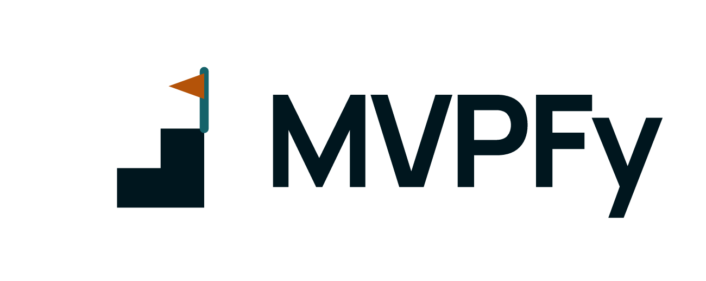

<p align="center">
  <a href="https://github.com/promovaweb/mvpfy">
    <picture>
      <source media="(prefers-color-scheme: dark)" srcset="https://raw.githubusercontent.com/promovaweb/mvpfy/main/brand/logo/logo-dark.png">
      
    </picture>
  </a>
</p>

<h1 align="center">MVPFy</h1>

<p align="center">
  Transforma uma ideia inicial no plano do primeiro produto SaaS, com entrevista guiada e um único documento MVP.md.
</p>

<p align="center">Um projeto da <a href="https://promovaweb.com">Promovaweb</a></p>

<p align="center">
  <a href="https://github.com/promovaweb/mvpfy/releases/latest"></a>
  <a href="https://www.npmjs.com/package/@promovaweb/mvpfy"></a>
  <a href="https://github.com/promovaweb/mvpfy/blob/main/LICENSE"></a>
</p>

<p align="center">
  <a href="https://promovaweb.com/discord"></a>
</p>

<p align="center">
  <a href="https://promovaweb.com/docs/mvpfy/">Documentação</a> ·
  <a href="https://promovaweb.com/discord">Discord</a> ·
  <a href="https://promovaweb.com/planos?utm_source=github&utm_medium=readme&utm_campaign=mvpfy">Planos da Promovaweb</a> ·
  <a href="https://github.com/promovaweb/mvpfy/blob/main/CHANGELOG.md">Changelog</a>
</p>

## O que é

O MVPFy é um framework de skills e uma CLI para planejar o primeiro software
oferecido como serviço de uma empresa em formação. A conversa acontece com uma
pergunta por turno, três respostas prontas, `4. Avançar` e `5. Conversar mais
sobre este tema`. Cada resposta é gravada antes do turno seguinte. A entrevista
fechada tem no máximo oito perguntas.

No fim, o projeto consumidor recebe um `MVP.md` com a análise de requisitos, o
problema, o público, as personas, a jornada, o escopo da versão 1.0, o modelo
SaaS, o modelo comercial, os custos, a tecnologia, o marketing, as métricas e
as próximas validações.

| Modo | Para quê |
| --- | --- |
| Skills no agente | conduzir a entrevista e consolidar o `MVP.md` |
| CLI `mvpfy` | instalar, atualizar, verificar e acompanhar o progresso |
| TUI | abrir o painel das áreas do plano no terminal |

## Instalação

Tenha o Node.js 22 ou superior instalado. Na raiz do projeto consumidor,
execute:

```bash
npx --yes @promovaweb/mvpfy install --project .
```

O comando instala as skills para Claude Code e Codex, cria `MVP.md` e `.mvpfy/`
e analisa o que já existe no projeto. Um segundo uso preserva as respostas e os
arquivos existentes.

Para usar o executável em qualquer pasta, instale o pacote de forma global:

```bash
npm install -g @promovaweb/mvpfy
```

Atualize as skills já instaladas com:

```bash
mvpfy update --project .
```

## Primeiros passos

1. Instale no projeto consumidor com o comando da seção anterior.
2. Confira se o documento e o CLI estão prontos.
3. Abra o agente, envie `$mvpfy` e descreva a ideia em um único texto.

A verificação mostra o estado do projeto. Os comandos abaixo supõem a
instalação global do pacote:

```bash
mvpfy doctor --project .
```

O resultado esperado tem o caminho do projeto, o estado do `MVP.md` e a
disponibilidade do CLI `skills`:

```text
Projeto  /home/pessoa/meu-saas
MVP.md   pendente
skills CLI  OK
```

Sem instalação global, use o pacote pelo `npx` em cada comando:

```bash
npx --yes @promovaweb/mvpfy doctor --project .
npx --yes @promovaweb/mvpfy progress --project .
```

## Uso

Acompanhe o preenchimento das áreas do plano:

```bash
mvpfy progress --project .
```

O resultado agrupa as áreas do plano, como Problema, Público, Produto, SaaS,
Tecnologia, Marketing e Validação. O percentual indica o preenchimento das
seções encontradas no `MVP.md`. Ele não substitui a leitura das hipóteses
abertas.

Abra o painel no terminal:

```bash
mvpfy --project .
```

A TUI tem as abas Home, Áreas, MVP.md, Skills e Sobre. A aba MVP.md é somente
para leitura e não altera o arquivo.

Atualize as skills depois de uma nova versão do framework:

```bash
mvpfy update --project .
```

Gerencie as skills pelo CLI oficial:

```bash
mvpfy skills install --project .
mvpfy skills update --project .
mvpfy skills list --project .
```

## Saída para scripts

Os comandos `progress` e `doctor` aceitam `--json`:

```bash
mvpfy progress --project . --json
```

O retorno do progresso traz `project`, `document`, `overall`, `status`,
`areas`, `pending_sections`, `tenancy`, `interview` e `next_gap`. Cada área
informa `percent`, `complete`, `total` e a lista de `sections`.

```json
{
  "project": "/home/pessoa/meu-saas",
  "document": true,
  "overall": 48,
  "status": "in_progress",
  "next_gap": {
    "id": "marketing",
    "label": "Marketing"
  }
}
```

## Uso com agentes

O MVPFy distribui as skills pelo [Skills CLI](https://github.com/vercel-labs/skills).
A instalação feita por `mvpfy install` cobre o [Claude Code](https://github.com/anthropics/claude-code)
e o [Codex](https://github.com/openai/codex). Os arquivos ficam no projeto
consumidor:

- `.claude/skills/` para o Claude Code.
- `.agents/skills/` para o Codex.

A porta de entrada é a skill `mvpfy`. Ela chama as especialistas por área,
grava o estado em `.mvpfy/` e atualiza o `MVP.md`.

O `mvpfy-context` lê specs, briefs, backlogs e arquivos de código do projeto
para evitar perguntas repetidas. A leitura é somente de referência. O MVPFy não
cria, altera ou migra arquivos do [Specsfy](https://github.com/promovaweb/specsfy).

## O plano que você recebe

O `MVP.md` começa pela seção **Analise de Requisitos**, com a descrição inicial
e o texto original de cada resposta. Depois seguem as áreas de planejamento. O
estado do documento aparece em um destes valores:

| Estado | Significado |
| --- | --- |
| `preliminary` | há conteúdo aproveitável, mas faltam escolhas importantes |
| `ready` | os campos mínimos do primeiro SaaS estão descritos |
| `validated` | as hipóteses principais foram conferidas fora da entrevista |

O arquivo usa marcadores estáveis, como `<!-- mvpfy:section:problem-definition -->`.
Uma atualização do template encontra o conteúdo pelo identificador e preserva o
texto escrito à mão fora dos blocos gerados.

## Documentação

- [Guia do MVPFy no site](https://promovaweb.com/docs/mvpfy/): manual publicado.
- [Guia do usuário](https://github.com/promovaweb/mvpfy/blob/main/docs/user/README.md):
  percurso completo da instalação ao plano pronto.
- [Ebook em PDF](https://github.com/promovaweb/mvpfy/blob/main/ebooks/ebook-mvpfy.pdf)
  e [EPUB](https://github.com/promovaweb/mvpfy/blob/main/ebooks/ebook-mvpfy.epub):
  edição portátil do guia do usuário.
- `mvpfy --help` e `mvpfy <comando> --help`: referência dos comandos no
  terminal.

## Feito com

| Projeto | Para quê |
| --- | --- |
| [Node.js](https://github.com/nodejs/node) | runtime da CLI e dos scripts das skills |
| [Commander](https://github.com/tj/commander.js) | comandos e opções da CLI |
| [marked](https://github.com/markedjs/marked) | renderização do `MVP.md` na TUI |
| [marked-terminal](https://github.com/mikaelbr/marked-terminal) | saída do Markdown no terminal |
| [neo-blessed](https://github.com/embark-framework/neo-blessed) | interface de terminal |
| [Skills CLI](https://github.com/vercel-labs/skills) | instalação e atualização das skills |
| [Claude Code](https://github.com/anthropics/claude-code) | agente que recebe as skills |
| [Codex](https://github.com/openai/codex) | agente que recebe as skills |

## Comunidade e suporte

- **Discord:** [obter ajuda e conversar com a Comunidade](https://promovaweb.com/discord).
- **Bugs e pedidos:** abra uma [issue](https://github.com/promovaweb/mvpfy/issues)
  com a versão, o sistema operacional e o passo a passo para reproduzir.
- **Novidades:** acompanhe o [CHANGELOG](https://github.com/promovaweb/mvpfy/blob/main/CHANGELOG.md)
  e as [releases](https://github.com/promovaweb/mvpfy/releases).

## Contribuir

O projeto aceita contribuições de código, documentação, skills e testes. Leia o
[CONTRIBUTING.md](https://github.com/promovaweb/mvpfy/blob/main/CONTRIBUTING.md)
antes de abrir um pull request. Ele traz o ambiente, a organização do código,
os comandos de validação e o fluxo de release.

## Promovaweb

O MVPFy é mantido pela [Promovaweb](https://promovaweb.com), comunidade de
co-working digital onde profissionais aprendem a construir, automatizar e
gerir negócios de tecnologia e IA com aulas ao vivo, Co-works e revisão de
projetos reais.

Quer usar o MVPFy em projetos de verdade, com acompanhamento? Conheça os
[planos da Promovaweb](https://promovaweb.com/planos?utm_source=github&utm_medium=readme&utm_campaign=mvpfy).

## Licença

Distribuído sob a
[GNU AGPL 3.0](https://github.com/promovaweb/mvpfy/blob/main/LICENSE). A
licença não concede o uso do nome e do logo do MVPFy nem da marca Promovaweb
(AGPL 3.0, seção 7, item e).
